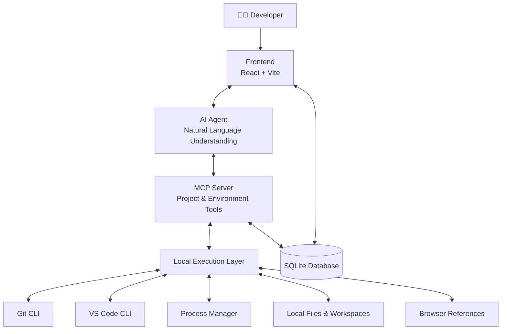
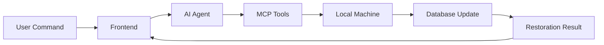
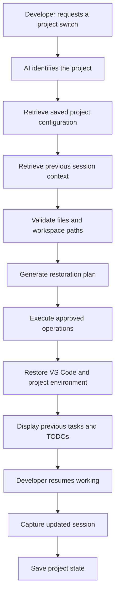

# 🔀 SWITCHBOARD
### AI-Powered Developer Context Switcher & Environment Restorer

**Don't just switch projects. Pick up exactly where you left off.**
---

## 💡 The Problem

Developers rarely work on just one project.

A typical student developer might simultaneously handle:
- College assignments and coursework.
- Hackathon projects.
- Personal GitHub repositories.
- Research papers and documentation.
- Freelance or internship projects.

Every time they switch between projects, they have to manually reconstruct their working environment.

This often involves:

- Finding and opening the correct project directory.
- Reopening the correct VS Code workspace.
- Checking the current Git branch and uncommitted changes.
- Reopening terminals and restarting development servers.
- Finding relevant browser tabs and documentation.
- Remembering unfinished tasks and previous decisions.
- Recovering the context of their last working session.

**The real problem isn't switching applications. It's losing the context of what you were doing.**

This repetitive process wastes time, interrupts concentration, and reduces productivity.

## 🚀 Our Solution

**SWITCHBOARD** is an AI-powered developer workspace orchestrator that remembers, manages, and restores the working environment of different projects.

Instead of manually reopening everything, developers can simply tell SWITCHBOARD:

> "Switch to my IEEE research paper."

SWITCHBOARD understands the request, retrieves the project's saved configuration and previous session context, prepares the required environment, and restores the developer's workspace.

It can manage:

- Local Git repositories.
- VS Code workspaces.
- Project-specific terminal configurations.
- Development servers and background processes.
- Browser bookmarks and project references.
- Project TODOs and handoff notes.
- Previous working sessions.

### Our Core Idea

**A project should remember where you left off, so you don't have to.**

---

## ⚙️ How It Works

SWITCHBOARD follows five major stages to provide an intelligent project-switching experience.

### 1. Project Registration

Developers register their projects with SWITCHBOARD.

Each project stores:
- Project name and local repository path.
- Git repository and current branch.
- VS Code workspace path.
- Required terminal commands.
- Required development services.
- Relevant browser references.
- Project-specific notes and TODOs.

### 2. Context Capture

When switching away from a project, SWITCHBOARD captures its current state.

It records:
- Current Git branch and uncommitted changes.
- Project and workspace information.
- Configured terminal commands.
- Managed development services.
- Last working task.
- Pending TODOs and important notes.

It then generates a session handoff note summarizing where the developer left off.

### 3. Intelligent Context Processing

The AI agent interprets natural-language commands and determines which project the developer wants to access.

For example:

> "Take me back to my IEEE paper."

The agent:
1. Identifies the intended project.
2. Retrieves its saved configuration.
3. Retrieves the previous session summary.
4. Checks whether required paths and files exist.
5. Creates an environment restoration plan.

### 4. Environment Restoration

SWITCHBOARD executes the restoration plan.

It:
- Opens the correct repository.
- Launches VS Code with the appropriate workspace.
- Opens relevant files.
- Restarts configured development services.
- Opens saved browser references.
- Displays the previous session summary.
- Recovers unfinished tasks.

### 5. Continuous Project Memory

After each session, SWITCHBOARD updates the project's saved state.

Every subsequent session builds on the previous one, providing more useful handoff information and a smoother restoration experience.

---

## 🏗️ System Architecture

SWITCHBOARD uses a modular architecture that separates the user interface, AI reasoning, tool execution, and persistent project storage.

### High-Level Architecture

### Architecture Components

| Component | Responsibility |
|---|---|
| **Frontend** | Provides the chat interface and project dashboard. |
| **AI Agent** | Understands natural-language commands and determines the required operations. |
| **MCP Server** | Exposes project-management and environment-restoration tools to the AI agent. |
| **Local Execution Layer** | Interacts with Git, VS Code, terminals, files, and managed processes. |
| **SQLite Database** | Stores project configurations, session snapshots, TODOs, and working history. |

### How Data Flows

The **Model Context Protocol (MCP)** server acts as the bridge between the AI agent and the developer's local environment, allowing the agent to interact with structured tools rather than directly manipulating the system.

### Session Restoration Workflow

---

## ✨ Key Features

### 1. Natural-Language Project Switching
Switch between projects using simple conversational commands.

Examples:
- "Switch to my college assignment."
- "Open my SIH project."
- "Return to my IEEE paper."
- "Show me what I was doing yesterday."

### 2. Workspace Restoration
Restore project directories, VS Code workspaces, selected files, terminal configurations, and saved references.

### 3. Smart Session Memory
Remember:
- Last working task.
- Previous working session.
- Unfinished TODOs.
- Important decisions.
- Known blockers.

### 4. Git Awareness
Get an overview of the repository's current state:

- Current branch.
- Uncommitted changes.
- Modified files.
- Last commit.
- Repository cleanliness.

SWITCHBOARD preserves uncommitted work and never automatically discards Git changes.

### 5. Process Management
Start and stop project-specific development servers.

For example:
- Project A requires a React development server.
- Project B requires a Python FastAPI server.
- Project C requires a local database.

Only configured and managed services are controlled by SWITCHBOARD.

### 6. Browser Context
Reopen project-related references, including:
- Documentation.
- Research papers.
- GitHub issues.
- API references.
- Project-specific websites.

### 7. Session Timeline
View previous working sessions, understand which projects were accessed, and track what was completed.

---

## 🛠️ Technology Stack

| Layer | Technologies |
|---|---|
| Frontend | React, Vite, Tailwind CSS |
| Backend | Python, FastAPI |
| AI | LLM API, Structured Tool Calling |
| Agent Integration | Model Context Protocol (MCP) |
| Database | SQLite |
| Version Control | Git CLI |
| IDE Integration | VS Code CLI |
| Process Management | Python Subprocess, psutil |

### Why These Technologies?

- **React + Vite:** Fast and responsive developer-facing interface.
- **FastAPI:** Lightweight backend for handling application requests.
- **LLM API:** Enables natural-language project commands and session summarization.
- **MCP:** Provides a standardized tool interface between the AI agent and local environment.
- **SQLite:** Lightweight persistent storage for project configurations and session history.
- **Git CLI:** Provides direct access to repository information and working-tree status.

---

## 🔐 Safety & Reliability

Since SWITCHBOARD interacts with local files and running processes, safety is a core architectural consideration.

Our safety principles include:

- Never automatically delete files.
- Never discard uncommitted Git changes.
- Never terminate arbitrary background processes.
- Only manage processes started and registered by SWITCHBOARD.
- Ask for confirmation before stopping a process.
- Never expose API keys or environment variables in AI prompts.
- Require explicit confirmation for destructive or disruptive operations.
- Maintain an audit log of executed operations.

**The objective is to restore the developer's environment without putting their existing work at risk.**

---

## 🎯 Hackathon MVP

Our initial implementation focuses on demonstrating the core concept with three registered projects.

The MVP aims to support:

- [x] Registering multiple local projects.
- [x] Saving project configurations.
- [ ] Natural-language project switching.
- [ ] Opening the correct VS Code workspace.
- [ ] Capturing Git status and branch information.
- [ ] Starting configured development servers.
- [ ] Saving and displaying session handoff notes.
- [ ] Displaying pending TODOs during restoration.

*Update the checklist to reflect the actual implementation status before submission.*

Future extensions include browser automation, Discord/Slack integration, and advanced process management.

---

## 🎬 Demonstration Scenario

To demonstrate SWITCHBOARD, we use three different development projects.

| Project | Working Environment | Unfinished Task |
|---|---|---|
| SIH Hackathon | React frontend, Python backend | Authentication API integration |
| IEEE Research Paper | LaTeX files, reference PDFs | Literature review |
| College Assignment | Python repository, Jupyter notebooks | Assignment TODOs |

### Demo Workflow

1. Start working on the SIH Hackathon project.
2. Make a small code change.
3. Ask SWITCHBOARD to save the current session.
4. Switch to the IEEE research paper using a natural-language command.
5. Observe the correct workspace and reference materials opening.
6. Ask SWITCHBOARD what was unfinished in the paper.
7. Switch back to the SIH project.
8. Observe the restored project context, Git information, and pending tasks.

**The demonstration proves that developers can move between projects without manually reconstructing their working environments.**

---

## 🌟 What Makes SWITCHBOARD Different?

SWITCHBOARD is not another application launcher.

| Traditional Application Launcher | SWITCHBOARD |
|---|---|
| Opens applications | Restores project workspaces |
| Opens folders | Understands project configurations |
| Requires manual context recovery | Retrieves previous session context |
| Does not track unfinished work | Remembers pending TODOs |
| Does not manage project-specific services | Restores configured development services |
| Treats every session independently | Maintains continuous project memory |

Our key differentiator is the combination of **AI-powered environment orchestration and persistent project-level memory**.

Instead of simply opening a project, SWITCHBOARD attempts to restore the state of work surrounding that project.

---

## 🔮 Future Scope

Potential extensions include:

- Discord and Slack conversation context integration.
- Browser tab and session restoration.
- More IDE integrations.
- Intelligent task prioritization.
- Advanced process suspension and resumption.
- Cross-device project context synchronization.
- Automated project activity summaries.
- Deeper integration with GitHub issues and pull requests.

---

## 👥 Team & Contributors

Built with the goal of making multi-project development more seamless.

**Team:** [Your Team Name]

**Contributors:**
- [Member 1]
- [Member 2]
- [Member 3]
- [Member 4]

---

## 📌 Vision

We want to make project switching as simple as changing a conversation.

Developers should spend their time writing code, solving problems, and building products — not remembering which terminal they left open or which task they were working on.

**SWITCHBOARD – Your work, remembered. Your workspace, restored.**

---

  <b>Built for developers who work on more than one thing.</b>

